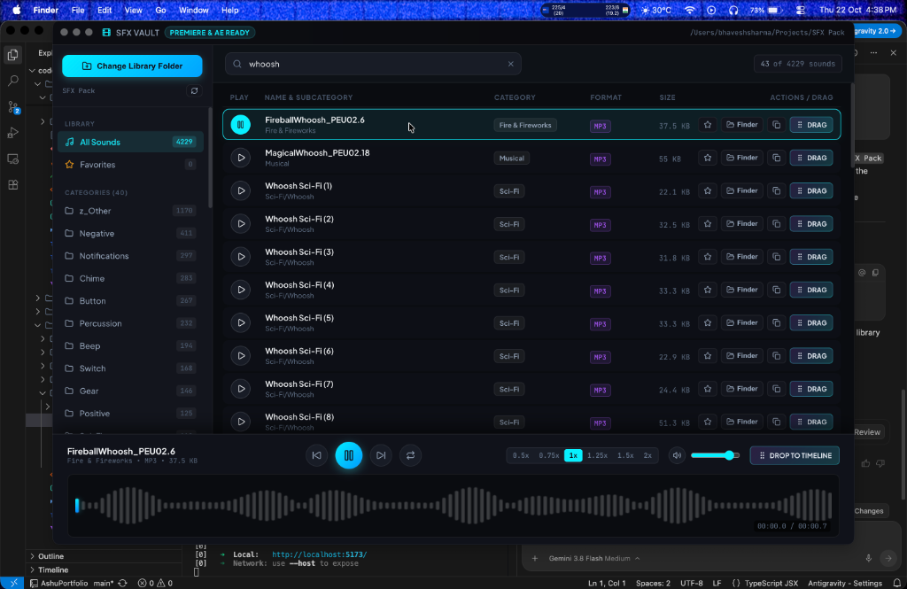

# SFX Vault 🎵

> A blazing-fast, modern Sound Effects (SFX) Library Browser built for video editors, sound designers, and motion designers. Audition audio with live waveforms, apply real-time studio effects (reverse, pitch, anti-repetition, filters), and **drag directly into Adobe Premiere Pro & After Effects timelines**.

---

<p align="center">
  
</p>

---

## 💡 Why SFX Vault?

Video editors typically face two frustrating workflows:
1. **Digging through macOS Finder**: Trying to audition audio one by one with the Spacebar, with no waveforms, no pitch adjustment, and messy folder navigation.
2. **Importing massive SFX folders into Premiere / AE**: Bloating the project file (.prproj / .aep), slowing down autosaves, and cluttering project bins with thousands of unused sounds.

**SFX Vault bridges this gap**: Keep your entire SFX collection external on your drive, audition with real-time interactive waveforms, shape the sound with the built-in FX Rack, and **drag only what you need directly onto your Premiere Pro or After Effects timeline**.

---

## ✨ Core Features

### 🎯 Direct Drag-and-Drop into Premiere Pro & After Effects
- **Timeline & Bins**: Drag the **`DRAG`** badge directly onto any audio track (`A1`, `A2`, etc.) in your Premiere sequence, or drop it into your project bin.
- **Native OS Drag Session**: Uses macOS Cocoa's native `NSPasteboard` (`NSFilenamesPboardType` / `public.file-url`) under the hood. To Premiere and After Effects, dragging from SFX Vault is **identical to dragging out of macOS Finder**.
- **`Cmd + V` Clipboard Import**: Click the **`Copy`** button on any sound, switch to Premiere/AE, and press `Cmd + V` to import immediately without dragging across multiple monitors!

### 🎛️ Studio FX Rack (Process Before Dragging!)
Shape your audio in real-time before dragging it into your sequence:
- **🔄 Reverse Audio**: 1-click reverse. Turns whooshes into swoops, impacts into reverse suck-backs, and cymbals into tension risers.
- **🎲 Anti-Repetition / Humanize**: Solves repetitive sounds! Automatically randomizes pitch variation (±0.8 to ±2.0 semitones) so repeated gunshots, footsteps, UI clicks, or whooshes never sound robotic or identical.
- **🌊 Underwater / Muffled**: 750 Hz Low-Pass filter for behind-the-wall, muffled, or underwater perspectives.
- **📻 Radio / Walkie-Talkie**: 1400 Hz Band-Pass filter for telephone, megaphone, and intercom sound design.
- **⚡ Crisp Air**: High-Shelf boost (+6 dB at 3.2 kHz) for bright, airy cinematic presence.
- **📈 Fade In & Fade Out**: Smooth 120ms attack and 250ms tail envelopes to eliminate pops and clicks.
- **🎚️ Advanced FX Drawer**:
  - **Pitch Shift**: `-12 st` to `+12 st` semitones.
  - **Echo / Delay**: Adjustable dry/wet slapback echo tail.
  - **Reverb Space**: Algorithmic stereo hall reverb.
  - **Warmth & Grit**: Analog saturation / distortion drive.
  - **Stereo Pan**: Position audio from 100% Left to 100% Right.

> **🔥 Pro Dragging with FX**: When any effect is active, dragging automatically renders an uncompressed **48 kHz studio WAV** in milliseconds (`Whoosh_REV_PITCH-2_ECHO.wav`) and drops the processed file straight into your timeline!

### 🌊 Real-Time Canvas Waveforms
- Mirrored canvas audio waveform rendered with Web Audio API.
- Click and scrub anywhere along the playhead to audition specific moments.
- Live time readout (`00:00.0 / 00:01.2`).

### 📁 Instant Library Scanner & Smart Categorization
- Click **"Choose SFX Library"** and point to any folder on your Mac (even folders with 5,000+ files).
- Recursively scans `.wav`, `.mp3`, `.ogg`, `.flac`, `.aif`, `.aiff`, `.m4a`, and `.aac`.
- Automatically categorizes sounds based on your nested folder structure (*Action, Ambience, Whoosh, UI, Foley, etc.*).
- Filter by file extension (`WAV`, `MP3`, `AIFF`, etc.).
- High-performance progressive scroll rendering ensures silky-smooth 60fps browsing across thousands of files.

### 🔍 Live Fuzzy Search
- Instant filtering across title, subfolder, file format, and category.
- Press `Esc` or the clear button to reset instantly.

### 📁 One-Click macOS Finder Reveal
- Click the **`Finder`** button on any sound row to immediately open macOS Finder with that exact file highlighted.

---

## ⌨️ Keyboard Shortcuts

| Shortcut | Action |
| :--- | :--- |
| **`Spacebar`** | Play / Pause selected sound |
| **`Down Arrow` / `Right Arrow`** | Select and play next sound |
| **`Up Arrow` / `Left Arrow`** | Select and play previous sound |
| **`Double Click`** | Play sound row |

---

## 🚀 Installation & How to Run

### Prerequisites
- **macOS** (Apple Silicon or Intel) or **Windows 10 / 11**
- [Node.js](https://nodejs.org/) (version 18 or newer recommended)

### 1. Clone the Repository
```bash
git clone https://github.com/bhaveshkys/sfx-vault.git
cd sfx-vault
```

### 2. Install Dependencies
```bash
npm install
```

### 3. Run in Development Mode
To start the app with hot-reloading on **macOS** or **Windows**:
```bash
npm run dev
```

---

## 📦 How to Install Permanently

### On macOS:
```bash
npm run install:mac
```
This builds and installs directly into **`/Applications/SFX Vault.app`**.
- Launch with **Spotlight** (`Cmd + Space` -> type `SFX Vault`)
- Open from **Finder -> Applications -> SFX Vault**
- Drag to your **Mac Dock** to keep it pinned next to Premiere Pro & After Effects!

### On Windows:
```bash
npm run build
npm start
```
Or run `npm run dev` from PowerShell / Command Prompt. It runs with native Windows window framing (minimize/maximize/close buttons) and connects directly to Windows Adobe Premiere Pro and After Effects!

---

## 💻 Cross-Platform Features (macOS & Windows)

| Feature | macOS | Windows |
| :--- | :--- | :--- |
| **Premiere & AE Drag** | Native `NSPasteboard` session | Native `CF_HDROP` OLE drop target |
| **Instant Clipboard Copy** | `Cmd + V` paste into Premiere/AE | `Ctrl + V` paste into Premiere/AE |
| **File Reveal** | 1-click **Finder** highlight | 1-click **Windows Explorer** highlight |
| **Window Frame** | Sleek macOS traffic light controls | Native Windows 10/11 titlebar controls |
| **File Paths** | POSIX (`/Users/...`) | Windows drive letters (`C:\...`) |

---

## 📤 Sharing with Friends

If your friends want to use SFX Vault with their own local SFX packs without touching code or terminal:

1. Run the build command:
   ```bash
   npm run install:mac
   ```
2. Compress the built app:
   ```bash
   cd release && zip -r "SFX-Vault-mac.zip" "SFX Vault.app"
   ```
3. Send `SFX-Vault-mac.zip` to your friends (via Google Drive, WeTransfer, or GitHub Releases).
4. They unzip it and drag **`SFX Vault.app`** into their **`/Applications`** folder. Done!

---

## 🛠️ Tech Stack

- **Frontend**: React 19, TypeScript, Vite 6
- **Desktop Engine**: Electron 34 with macOS Native Drag IPC (`event.sender.startDrag`)
- **Audio Processing**: Web Audio API (`OfflineAudioContext`, `BiquadFilterNode`, `DelayNode`, `ConvolverNode`, `StereoPannerNode`)
- **Icons**: Lucide React
- **Design**: Dark Studio / Cyberpunk luxury aesthetic with electric cyan accents

---

## 📄 License

MIT License. Free for personal and commercial video editing and sound design workflows.
